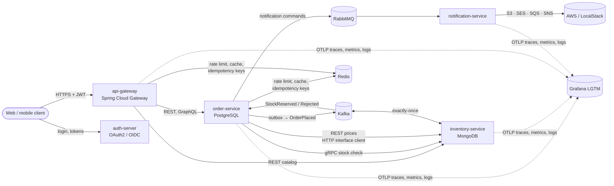

# Spring Boot Showcase: microservices with Spring Boot 4, Spring Framework 7 and Java 21

A realistic e-commerce backend built to **teach** modern Spring. Every class, configuration file and
build file is heavily commented, and the [`docs/`](docs) folder explains each topic in depth.

> **Versions:** Spring Boot **4.1.2** · Spring Framework **7.0** · Spring Security **7.1** ·
> Spring Cloud **2025.1.4** · Spring Cloud AWS **4.2** · Hibernate **7** · Jackson **3** · Java **21** ·
> Testcontainers **2**
>
> Spring Boot 4 is built on Spring Framework 7. (Spring Framework 6 is the foundation of Spring Boot 3.)
> [docs/02](docs/02-spring-boot-4-and-framework-7.md) explains what changed between the two generations.

---

## Architecture at a glance



| Module | What it demonstrates |
|---|---|
| [`contracts`](contracts) | Shared event records (sealed interfaces), gRPC `.proto`, UUIDv7, messaging names |
| [`auth-server`](auth-server) | Spring Authorization Server (now part of Spring Security 7): OAuth2.1/OIDC, PKCE, client credentials, custom JWT claims |
| [`api-gateway`](api-gateway) | Spring Cloud Gateway 5 (WebFlux): routing, JWT at the edge, Redis rate limiting, circuit breaker + fallback, retries, legacy-path rewrite |
| [`order-service`](order-service) | **Flagship.** REST + API versioning, GraphQL, JPA/Hibernate 7, transactions (propagation, isolation, locking), Flyway, complex indexes and SQL, transactional outbox → Kafka, idempotent consumer, saga, RabbitMQ, Redis cache + idempotency keys, gRPC client, Resilience4j + Spring 7 `@Retryable`/`@ConcurrencyLimit`, security filters, actuator, observability, ArchUnit |
| [`inventory-service`](inventory-service) | MongoDB documents, indexes and aggregation pipeline, multi-document transactions, gRPC server (unary + streaming), Kafka exactly-once |
| [`notification-service`](notification-service) | RabbitMQ topology (topic exchange, quorum queues, DLX), Spring Cloud AWS: S3, SES, SQS, SNS, Secrets Manager |

---

## Quick start

**Prerequisites:** JDK 21+, Docker (for compose and Testcontainers). Maven is optional: use the wrapper, or
your own Maven 3.9+.

```bash
# 1. Build everything and run unit + slice tests (no Docker needed)
mvn verify -Pfast

# 2. Full build including Testcontainers integration tests (needs Docker)
mvn verify

# 3. Start the whole platform: infrastructure + all 5 services
cp docker/secrets/postgres_password.example.txt docker/secrets/postgres_password.txt
docker compose --profile apps up -d --build

# ...or only the infrastructure, then run services from your IDE
docker compose up -d
```

UIs: Grafana http://localhost:3000 · RabbitMQ http://localhost:15672 (showcase/showcase) ·
Swagger http://localhost:8081/swagger-ui.html · GraphiQL http://localhost:8081/graphiql ·
Kafka UI http://localhost:8090 (`--profile tools`).

### Try the saga (curl)

```bash
# Get a token (client-credentials grant)
TOKEN=$(curl -s -u machine-client:machine-secret \
  -d "grant_type=client_credentials&scope=orders.read orders.write" \
  http://localhost:9000/oauth2/token | jq -r .access_token)

# Place an order through the gateway (idempotent POST)
curl -i -X POST http://localhost:8080/api/orders \
  -H "Authorization: Bearer $TOKEN" -H "Content-Type: application/json" \
  -H "Idempotency-Key: my-first-order-0001" \
  -d '{"shippingAddress":{"street":"1 Main St","city":"Amsterdam","postalCode":"1011","country":"NL"},
       "items":[{"sku":"SKU-0001","quantity":2},{"sku":"SKU-COFFEE","quantity":3}],
       "discountCode":"COFFEE3FOR2"}'

# A moment later the saga has confirmed it. API version 2 includes the status history.
curl -s http://localhost:8080/api/orders/<id> -H "Authorization: Bearer $TOKEN" -H "X-API-Version: 2" | jq
```

More requests (GraphQL, cancellation, webhooks, admin reports) are in [`http/requests.http`](http/requests.http).

---

## How this project was verified

The build compiles against the real Spring Boot 4.1.2 artifacts, and **`mvn verify` passes for all 7 modules (59 unit and
slice tests)**. In addition, the whole system was started on real infrastructure (PostgreSQL 17, MongoDB 8
replica set, Kafka 4 in KRaft mode, Redis) and exercised end to end:

- order placed → outbox → Kafka → MongoDB reservation (multi-document transaction) → `StockReserved` → order **CONFIRMED**
- idempotent replay (200 with the same order), gRPC pre-check rejection (422 Problem Details), cancellation → compensating `StockReleased`
- GraphQL batch loading, keyset pagination, API versioning (v1/v2/unsupported → 400)
- security: 401 without a token, 403 for missing roles/scopes, 401 for a tampered signature, partner API key → 202
- gateway: routing, legacy path rewrite, **Redis rate limiting (20 × 200, then 429)**, circuit-breaker fallback (503 Problem Details)
- all 13 reporting queries (window functions, recursive CTE, LATERAL, ROLLUP, percentiles...) on 50,000 demo orders, with
  `EXPLAIN ANALYZE` confirming index-only scans, partial and GIN index usage ([docs/05](docs/05-database-indexes-and-queries.md))

Building it surfaced several **real-world gotchas**. Each is fixed and documented where it occurs
([docs/20](docs/20-lessons-learned.md)).

---

## Learning path

| # | Guide | Topics |
|---|---|---|
| 00 | [Architecture & system design](docs/00-architecture-and-system-design.md) | Context, saga, consistency, scaling, capacity, failure modes |
| 01 | [Spring Boot core features](docs/01-spring-boot-core-features.md) | Auto-configuration, starters, DI, profiles, configuration properties |
| 02 | [Spring Boot 4 & Spring Framework 7](docs/02-spring-boot-4-and-framework-7.md) | What's new vs Boot 3 / Spring 6, migration table |
| 03 | [Java 21 features](docs/03-java-21-features.md) | Records, sealed types, pattern matching, virtual threads, sequenced collections |
| 04 | [Transactions](docs/04-transactions.md) | Propagation, isolation, locking, pitfalls, outbox |
| 05 | [Database: indexes & complex queries](docs/05-database-indexes-and-queries.md) | Every index and query explained with real plans |
| 06 | [SQL vs NoSQL](docs/06-sql-vs-nosql.md) | PostgreSQL vs MongoDB, side by side in this repo |
| 07 | [Kafka vs RabbitMQ](docs/07-messaging-kafka-vs-rabbitmq.md) | When to use which, delivery semantics, DLQs |
| 08 | [REST, gRPC & GraphQL](docs/08-rest-grpc-graphql.md) | Trade-offs, versioning, N+1 |
| 09 | [Security: OAuth2, JWT, filters, OWASP](docs/09-security-oauth2-jwt-owasp.md) | Flows, filter chain, OWASP Top 10:2025 mapping |
| 10 | [Resilience](docs/10-resilience.md) | Timeouts, retries, circuit breakers, bulkheads, rate limits |
| 11 | [Caching, Redis & async](docs/11-caching-redis-async.md) | Cache patterns, idempotency keys, @Async, virtual threads |
| 12 | [Observability & production readiness](docs/12-observability-and-production-readiness.md) | Actuator, probes, metrics, tracing, logs |
| 13 | [Testing strategy](docs/13-testing-strategy.md) | Pyramid, slices, Testcontainers, ArchUnit |
| 14 | [Design patterns](docs/14-design-patterns.md) | Pattern → where it lives in the code |
| 15 | [AWS](docs/15-aws.md) | Spring Cloud AWS, deployment architecture, IAM |
| 16 | [Docker](docs/16-docker.md) | Multi-stage, layers, CDS, compose deep dive |
| 17 | [Maven build](docs/17-maven-build.md) | Reactor, BOMs, plugins, profiles |
| 18 | [GitLab CI/CD](docs/18-gitlab-ci.md) | Pipeline walkthrough |
| 19 | [Clean code & code review](docs/19-clean-code-and-code-review.md) | Principles + review checklist |
| 20 | [Lessons learned](docs/20-lessons-learned.md) | Real gotchas hit while building this |

Architecture decisions are recorded in [`docs/adr`](docs/adr).

## Repository layout

```
.
├── pom.xml                  # parent + aggregator POM (heavily commented)
├── Dockerfile               # one multi-stage Dockerfile for every service (--build-arg MODULE=...)
├── docker-compose.yml       # full local platform (profiles: default infra, apps, tools)
├── .gitlab-ci.yml           # CI/CD pipeline
├── deploy/k8s               # Kustomize base + staging/production overlays
├── docker/                  # LocalStack init script, local secrets
├── http/requests.http       # runnable request collection (IntelliJ / VS Code REST Client)
├── docs/                    # the guides listed above + ADRs
└── <module>/                # contracts, auth-server, api-gateway, order-service, inventory-service, notification-service
```
