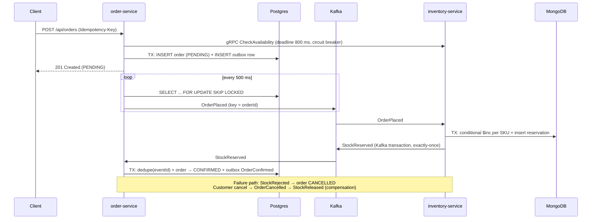

# 00 · Architecture & system design

This guide explains *why* the system looks the way it does. System design is about trade-offs, so each
section names the alternative that was rejected and why.

## 1. Requirements (what we're designing for)

**Functional:** customers browse a catalog, place orders, see their orders, and cancel them. Stock must
never be oversold. Customers get emails. Operations staff see reports.

**Non-functional (the drivers of the design):**

| Quality | Target | Design response |
|---|---|---|
| Availability | Ordering survives an inventory outage | Async saga + degraded mode (accept as PENDING) |
| Consistency | No overselling, no lost orders | Atomic stock updates, transactional outbox, idempotent consumers |
| Latency | p95 < 300 ms for POST /orders | Remote calls outside DB transactions, parallel price lookups on virtual threads, caching |
| Scalability | 10× traffic spikes (sales) | Stateless services, horizontal scaling, Kafka partitions, gateway rate limiting |
| Security | OWASP Top 10, least privilege | OAuth2/JWT, deny-by-default, defense in depth (gateway + service) |
| Operability | Diagnose an incident in minutes | Traces + metrics + structured logs correlated by trace id, health probes |

## 2. Service decomposition

Services follow **bounded contexts** (Domain-Driven Design): *Ordering*, *Inventory*, *Notification*,
*Identity*. Each service **owns its data**: no service reads another's database. This is the most
important microservice rule, because a shared database couples deployments and schemas.

| Service | Owns | Store | Why this store |
|---|---|---|---|
| order-service | orders, lines, outbox | PostgreSQL | Strong consistency, relational reporting, complex SQL |
| inventory-service | products, stock, reservations | MongoDB | Flexible per-category attributes, document reads, atomic per-document updates |
| notification-service | (stateless) | S3 for the receipt archive | Cheap, durable object storage |
| auth-server | users, clients, keys | In memory (demo) → DB/KMS in prod | |

**When NOT to use microservices:** a small team, an unclear domain, or no operational maturity (CI/CD,
observability, on-call). Start with a **modular monolith** (packages with enforced boundaries, for example
with Spring Modulith or ArchUnit as in `ArchitectureTest`) and extract services when there's a
reason: independent scaling, team autonomy, or a different technology need.

## 3. Communication styles

```
                  synchronous                         asynchronous
          ┌─────────────────────────────┐   ┌──────────────────────────────────┐
 query    │ REST (catalog prices)       │   │                                  │
          │ gRPC (stock pre-check)      │   │                                  │
          └─────────────────────────────┘   │                                  │
 command  │                             │   │ RabbitMQ (send email)            │
 event    │                             │   │ Kafka (OrderPlaced, StockReserved)│
                                            └──────────────────────────────────┘
```

* **Synchronous** when the caller needs the answer *now* to continue (a price for the total).
  The cost is temporal coupling: if the callee is down, the caller is affected. That's mitigated with
  timeouts, retries, circuit breakers and fallbacks ([docs/10](10-resilience.md)).
* **Asynchronous** when the work can happen later or fan out to many consumers. Coupling drops,
  but consistency becomes **eventual**, and the UI must handle "PENDING".

## 4. The order saga (distributed transaction without 2PC)

An order spans two databases (Postgres + Mongo). Two-phase commit (XA) is ruled out: it's slow, blocks
on coordinator failure, and Kafka/Mongo/Postgres don't share a transaction coordinator anyway. A
**saga** is a sequence of local transactions, each publishing an event that triggers the next step. On
failure, **compensating** actions undo earlier steps.



**Choreography vs orchestration.** Here services react to each other's events (choreography). That
suits a 2-3 step flow and has no single point of failure. With 5+ steps, the flow becomes hard to see
and debug. An **orchestrator** (a state machine in one service, or a workflow engine such as
Temporal or Camunda) then owns the sequence explicitly.

**Guarantees that make it safe:**

| Problem | Mechanism | Where |
|---|---|---|
| DB commit and Kafka publish aren't atomic | Transactional outbox | `OutboxWriter`, `OutboxRelay` |
| Relay or Kafka deliver duplicates | Idempotent consumer (processed_messages) | `InventoryEventHandler`, `ProcessedMessageStore` |
| Redelivered OrderPlaced | Reservation `_id = orderId` | `StockService` |
| Concurrent orders for the last item | Atomic conditional update | `StockService.reserveAll` |
| Events for one order out of order | Kafka key = orderId (same partition) | `OutboxRelay` |
| Client retries POST after a timeout | Idempotency-Key in Redis | `IdempotencyService` |
| Stale saga reply (order already cancelled) | State machine + `noRollbackFor` | `Order`, `OrderCommandService` |

## 5. Consistency, and CAP in practice

* Inside a service: **strong consistency** (ACID transactions in Postgres, multi-document transactions in Mongo).
* Across services: **eventual consistency**. The order is PENDING for a few hundred milliseconds.
* CAP: during a network partition, a distributed system chooses Consistency or Availability. The
  saga design chooses **availability** for order placement (accept as PENDING even if inventory is
  unreachable) and **consistency** for stock (never oversell; reject later if needed).
* PACELC adds: even without partitions, you trade **latency vs consistency**. The synchronous gRPC
  pre-check gives fast feedback (lower latency to "rejected"), while the async reservation stays the
  source of truth.

## 6. Scaling

| Layer | How it scales | Limit to watch |
|---|---|---|
| Gateway, services | Stateless → more pods (HPA on CPU) | Downstream capacity, DB connections |
| Postgres | Vertical first; read replicas for `readOnly` transactions; partition `orders` by month when huge | Connections (pool size × pods ≤ max_connections → use PgBouncer/RDS Proxy) |
| MongoDB | Replica set for HA; sharding by `sku` hash for write scale | Multi-document transactions get costly across shards |
| Kafka | Partitions = maximum parallelism per consumer group | Repartitioning breaks key ordering, so plan partitions up front |
| Redis | Cluster mode for sharding; replicas for HA | Hot keys (shard by key) |

**Back-of-the-envelope capacity** (good interview practice):

* 1M orders/day ≈ 12 orders/s on average; a sale peak of 20× ≈ 240 orders/s.
* Each order creates about 4 events (Placed, Reserved, Confirmed, notification) ≈ 1,000 msg/s at peak.
  A single Kafka partition handles 10k+ msg/s, so 6 partitions leave room for 6 parallel consumers.
* Storage: about 2 KB per order with lines ≈ 2 GB/day ≈ 730 GB/year. Plan partitioning and
  archiving (old orders to S3/Parquet for analytics).
* Postgres connections: 12 pods × 20 = 240 connections, which exceeds the default `max_connections`
  of 100-200. Use a pooler.

## 7. Caching strategy

| Data | Pattern | TTL | Invalidation |
|---|---|---|---|
| Prices | Cache-aside (`@Cacheable`) | 30 s | TTL (eventual) |
| Daily sales report | Cache-aside | 10 min | TTL |
| Catalog responses | HTTP caching (`Cache-Control: max-age=30`) | 30 s | TTL, CDN purge |
| Idempotency keys | Redis `SET NX EX` | 24 h | Expiry |
| Rate-limit buckets | Redis token bucket (gateway) | rolling | n/a |

Caching is covered in depth in [docs/11](11-caching-redis-async.md).

## 8. Failure modes & mitigations (pre-mortem)

| Failure | Effect | Mitigation |
|---|---|---|
| inventory-service down | Pre-check fails | Circuit breaker → `Unknown` → accept PENDING; saga completes later |
| Kafka down | Events stuck in the outbox | Orders still accepted; backlog visible (`outbox.backlog` gauge, DEGRADED health); relay drains on recovery |
| Poison message | Consumer stuck | 3 retries → dead-letter topic → alert (non-retryable errors go straight to the DLT) |
| Postgres failover | Short write outage | Hikari connection-timeout fails fast; retries with jitter; RDS Multi-AZ |
| Retry storm | Downstream overload | Exponential back-off + jitter, circuit breakers, gateway rate limiting |
| Slow dependency | Thread or connection exhaustion | Timeouts everywhere, `@ConcurrencyLimit` bulkheads, virtual threads |
| Bad deploy | Errors | Readiness probes gate traffic, rolling update with maxUnavailable=0, manual production gate |

## 9. What would change at 100× scale

* CDC (Debezium) instead of outbox polling; a schema registry (Avro/Protobuf) for event contracts.
* CQRS read models: project order events into a search store (OpenSearch) for queries.
* Postgres: partition `orders` by month, archive cold partitions, use PgBouncer.
* Multi-region: active-passive with replicated Kafka (MirrorMaker 2 / MSK Replicator), Aurora Global Database.
* An orchestrated saga (Temporal) once the flow grows (payments, shipping, loyalty points).
